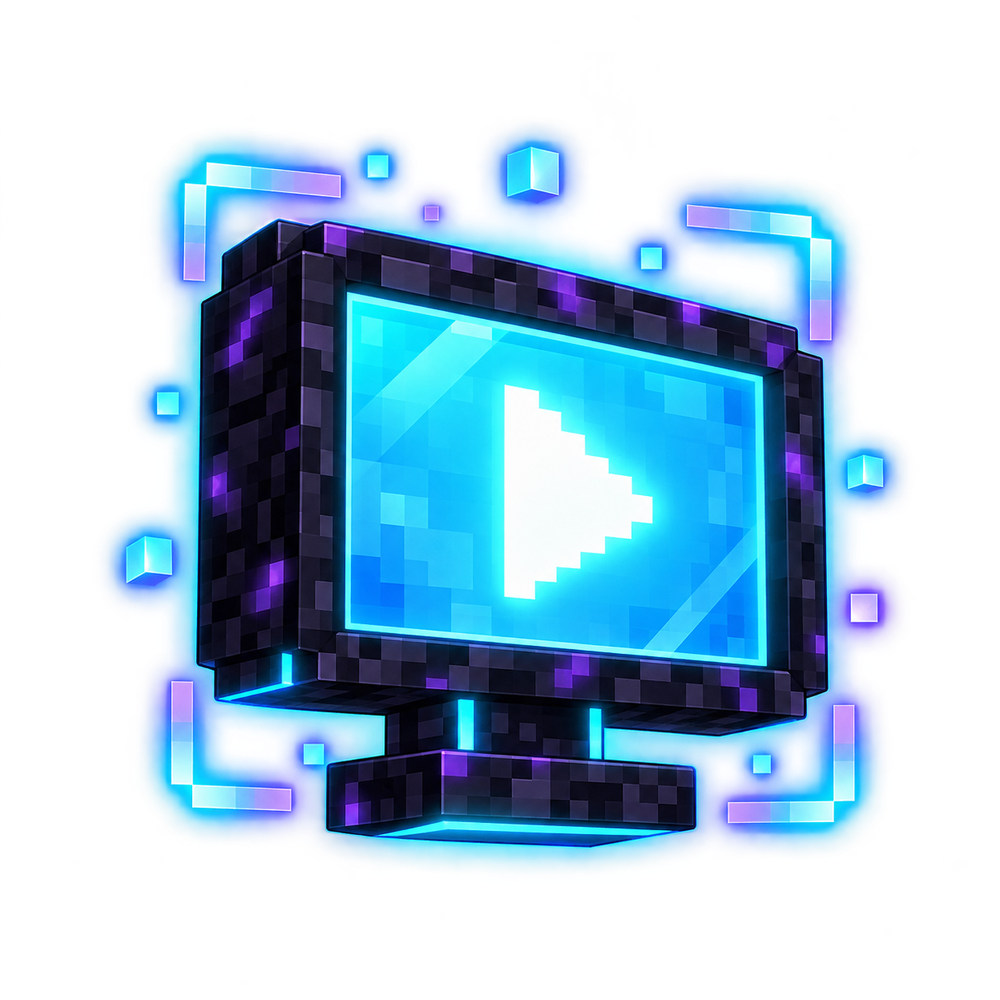

[](https://github.com/Aruvelut-123/dreamdisplaysx/releases/latest)
[](https://github.com/Aruvelut-123/dreamdisplaysx/blob/main/LICENSE)

<div align="center">
  
</div>

# Bring real video playback to Minecraft

Watch videos, livestreams, and more directly on in-game displays — together with your friends.

Create a display, paste a link and that's it!

[中文 README](README.md) · [Repository](https://github.com/Aruvelut-123/dreamdisplaysx)


Dream DisplaysX is a fork of [Dream Displays](https://github.com/arnodoelinger/dreamdisplays). Report problems with
this fork [here](https://github.com/Aruvelut-123/dreamdisplaysx/issues), not upstream.

# Watch anything

| Source | What works |
|---|---|
| **Twitch** | Live channels, VODs, and clips |
| **Kick** | Live channels and VODs |
| **Vimeo** | Public videos and live events |
| **Bilibili** | Videos, live channels, and bangumi episodes/seasons/movies |
| **Any video link** | Direct video files and live streams (`.m3u8` / `.mpd`) |
| **Share links** | Google Drive, Dropbox, and Imgur links are rewritten to the file they point at |
| **Pretty much anywhere else** | Not on the list? Try it anyway |

# Get started

Build a display out of black concrete, select it with a diamond axe and type `/display create`. Then look at it and
run `/display video <link> [language]`. Shift-right-click opens the display menu.

| Command | Side | What it does |
|---|---|---|
| `/display create` / `delete` | Server | Create / remove a display |
| `/display video <link> [language]` | Server | Play a video, stream, or ingest URL |
| `/display list` / `info` | Server | List / inspect displays |
| `/display on` / `off` | Server | Enable / disable every display |
| `/display login bilibili <sessdata>` | Server | Store the global Bilibili credential (OP only) |
| `/display logout bilibili` | Server | Delete the global Bilibili credential (OP only) |
| `/dlogin` / `/dlogoff` | Client | Open the Bilibili QR login screen / log out (OP only) |

`/dlogin` opens a QR code to scan with the Bilibili mobile app. The resulting `SESSDATA` is sent to the server,
stored AES-256-GCM encrypted, then synced across the server network and to online clients.

# Supported versions

Built for the following Minecraft versions (see the release badge above for the current version):

| Minecraft | Fabric | Forge | NeoForge | Paper |
|---|---|---|---|---|
| 1.18.2 | ✅ | ✅ | — | — |
| 1.19.4 | ✅ | ✅ | — | — |
| 1.20.1 | ✅ | ✅ | — | — |
| 1.21.1 | ✅ | — | ✅ | ✅ |
| 1.21.11 | ✅ | — | ✅ | ✅ |
| 26.1.2 | ✅ | — | ✅ | ✅ |
| 26.2 | ✅ | — | ✅ | ✅ |
| 26.3 | ✅ | — | ✅ | ✅ |

The Paper plugin is cross-version: one jar covers 1.21.1 – 26.3. Velocity and BungeeCord proxies are
version-independent as well.

# Download

Grab the `.jar` for your loader and Minecraft version from the
[latest release](https://github.com/Aruvelut-123/dreamdisplaysx/releases/latest):

- `dreamdisplayx-fabric-<mc>-<version>.jar` — Fabric / Quilt client or server mod
- `dreamdisplayx-forge-<mc>-<version>.jar` — Forge client or server mod (1.18.2 – 1.20.1)
- `dreamdisplayx-neoforge-<mc>-<version>.jar` — NeoForge client or server mod (1.21.1+)
- `dreamdisplayx-paper-<version>.jar` — Paper plugin
- `dreamdisplayx-velocity-<version>.jar` / `dreamdisplayx-bungeecord-<version>.jar` — proxy plugins

On the **client**, drop the jar into your mods folder. On the **server**, install the matching mod or plugin.

# Features

- **Seamless multiplayer playback** — local, synced, and broadcast modes; V3 batches packets and falls back to V2
- **Adjustable resolutions** up to 4K, with per-viewer audio and subtitle renditions (bilingual subtitles, HLS WebVTT)
- **Conforming displays** — stairs, slabs and mixed shapes share one fitted mesh for video, subtitles and danmaku
- **Per-display playlists** — database-backed queue (SQLite/MySQL) with approval, skip and end-of-queue policies
- **Permissions and claim protection** — LuckPerms, WorldGuard, and optional claim plugins
- **Video-derived dynamic lighting** (LambDynamicLights) and a Complementary shader patcher
- **Experimental ReplayMod / Flashback compatibility**

# What's new in this fork

- **Bilibili account login** — QR login (`/dlogin`), AES-256-GCM `SESSDATA` storage, global cross-server sync,
  VIP badge, search, Simplified Chinese, and danmaku
- **RTMP / RTMPS / SRT ingest** — feed an OBS-style stream into a display
- **libvlc playback engine** — JNA binding with decoupled video and audio clocks
- **Every platform** — Fabric, Forge, NeoForge, Paper, Velocity and BungeeCord builds

# Android (PojavLauncher / FCL / Zalith)

- Runs on **ARM64** and **x86_64** launchers; audio uses libvlc's OpenSL ES output
- Decode defaults to software `avcodec`; opt into a launcher MediaCodec bridge with `-Ddreamdisplayx.hwDecode=<module>`
- MobileGlues bounds the decoder thread pool and bypasses the PBO upload path that can produce black frames
- Subtitle and danmaku textures load an Android system CJK font when Cacio/AWT is available and degrade safely otherwise

# Playback engine: migrating from libvlc back to FFmpeg

The long-term goal of this branch is to **replace the playback engine wholesale, moving from libvlc
back to FFmpeg** — not to patch libvlc, and not merely to add one Android renderer. libvlc is an
all-in-one "demux + decode + render + audio" stack; moving back to FFmpeg means splitting those four
layers apart and driving each of them through FFmpeg's own APIs, until no in-process libvlc instance
is needed at all.

## Why migrate

- **Control.** libvlc hides demux, decode, render and the audio clock inside its own
  `libvlc_media_player`, exposing only a handful of options. When something like A/V drift, volume
  decay or "a DASH fragment is treated as end-of-stream" goes wrong, the only way to understand it is
  to reverse-engineer its internal state from logs.
- **Size and dependencies.** libvlc needs a full native runtime (including a plugin directory) for
  every platform, and on Android it drags in platform-specific traps — `libc++` SONAME collisions,
  `JNI_OnLoad` crashes, the `AudioTrack` instance cap. FFmpeg's JavaCPP binding is a single artifact
  that extracts the right native library per platform.
- **Testability.** Demuxing and decoding are pure data flows that can be verified without a player;
  libvlc's behaviour can only be checked on a real device.

## Current progress

The migration proceeds in stages and is **not finished**; libvlc is still the default and the only
engine in use:

| Component | Status | Notes |
|---|---|---|
| Session contract `PlaybackSession` | ✅ Done | The 37 call sites previously hard-wired in `MediaPlayer` are now an interface; `LibVlcSessionManager` is the first implementation (`backendName = "libvlc"`) |
| Demuxer `FfmpegDemuxer` | ✅ Done | `avformat_open_input` + `av_read_frame`, drops non-video packets automatically |
| Decoder `AndroidMediaCodecHwSolver` | ✅ Done | FFmpeg `h264_mediacodec` / `hevc_mediacodec`, emits packed BGRA |
| `FfmpegSession` implementation | 🚧 Not started | Wires the three above into a demux → decode → publish session; not connected yet |
| Desktop FFmpeg decode | 🚧 Not started | Only Android uses the MediaCodec backend so far |
| Moving audio off libvlc | 🚧 Not started | Audio still runs on libvlc's `:no-video` player |
| Removing the libvlc dependency | 🚧 Not started | The marker for a finished migration |

**Until the migration completes, turning on `enable-android-mediacodec` still behaves exactly like
libvlc** — the demuxer and decoder exist, but nothing drives them yet.

## What already landed

### Session contract

`PlaybackSession` defines the whole lifecycle the player needs: start, seek, quality handoff,
park/resume, frame delivery, audio control and teardown. `MediaPlayer` holds the interface rather than
a concrete class, so adding a backend does not touch the call sites, and no call site has to detect
the backend with an `is LibVlcSessionManager` check — `backendName` answers that.

### Demuxing

`FfmpegDemuxer` reads compressed packets through `avformat_open_input` → `avformat_find_stream_info`
→ `av_read_frame`, skipping and releasing audio/subtitle packets. `Referer` and `User-Agent` are
passed with `av_dict_set`, which is what makes CDN hotlink protection (Bilibili and friends) work.
The stream's `extradata` (H.264 SPS/PPS, H.265 VPS/SPS/PPS) is exposed because MediaCodec needs the
parameter sets at configure time.

### Decoding

`AndroidMediaCodecHwSolver` drives FFmpeg's mediacodec **NDK** backend with `ndk_codec=1` and
**references no `android.*` class**, so it loads on isolated game JVMs such as Pojav / Zalith, which
ship a desktop OpenJDK without `android.jar`.

Two implementation details that matter:

- **A hardware frame is not pixels.** mediacodec decoders emit `AV_PIX_FMT_MEDIACODEC`, whose
  `data(0)` is an opaque GPU surface handle; reading it as a plane faults or produces garbage. It has
  to go through `av_hwframe_transfer_data` first.
- **Output is packed BGRA.** `sws_scale` does the colour conversion and the planar-to-packed step in
  one pass, feeding the existing `FramePixelFormat.BGRA32` upload path. The GPU-YUV planar path is
  deliberately not used: it renders a black screen under Sodium and is permanently disabled.

### Configuration switch

`enable-android-mediacodec` (**default `false`**) gates the pipeline:

```toml
enable-android-mediacodec = true
```

It reaches the media layer as `PlaybackConfig.androidMediaCodecEnabled`; the default keeps hosts that
do not implement the property unchanged. Desktop short-circuits to `false` and never loads an Android
class.

# Building from source

```bash
git clone https://github.com/Aruvelut-123/dreamdisplaysx.git
cd dreamdisplaysx
./gradlew :platform:client:fabric:build :platform:client:neoforge:build
```

Multi-version builds use [Stonecutter](https://github.com/kikugie/stonecutter); version properties live in
`versions.json` and the active one in `versions/active.txt`. libvlc and SQLite natives are produced by CI and
downloaded on first boot into `./dreamdisplayx/natives/<os>/<arch>/`, never bundled into the jar.

# Disclaimer

Dream DisplaysX is not affiliated with the original Dream Displays project or Mojang Studios.

# Credits

- **[Dream Displays](https://github.com/arnodoelinger/dreamdisplays)** — the upstream project this fork is based on
- **[VideoPlayer-Library](https://github.com/squi2rel/VideoPlayer-Library)** — reference for the libvlc native build and packaging